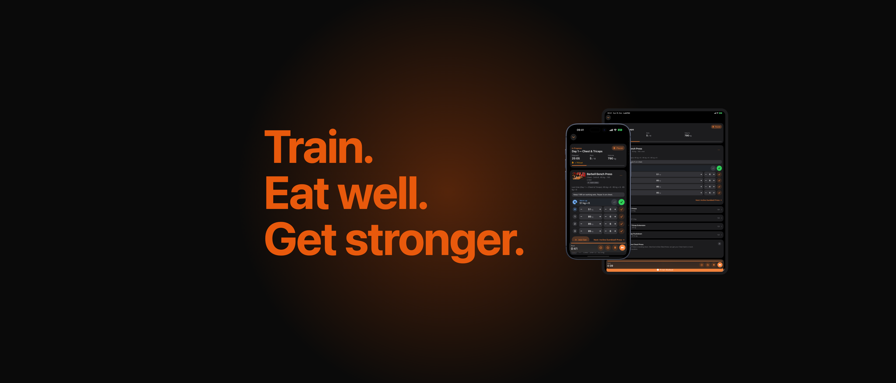

<!-- github-only:start -->

# LukiFitti

**The free, open-source workout tracker you train with your friends.**

[App Store](https://apps.apple.com/app/lukifitti/id6831508360) ·
[Web app](https://app.luki-fitti.tony-luke.de) ·
[Docs](https://docs.luki-fitti.tony-luke.de) ·
[Roadmap](https://github.com/users/tuke307/projects/4)

<!-- github-only:end -->

LukiFitti tracks your workouts, progression, stretching and meals on **Web (PWA)**, **iPhone**
and **Apple Watch**: offline-first, free forever, no ads, no subscription. Since 2.0 you can
train with friends in leagues, duels and weekly raid bosses.

## Features

- **Workouts that work offline:** log every set with one tap, swap exercises, rest timer, on
  the web, iPhone and a standalone Apple Watch app with heart rate.
- **Progression on autopilot:** suggestions for when to add weight or reps, based on your own
  history.
- **Stretching, meals and body data:** guided routines, calorie and macro tracking, AI meal
  estimates with your own OpenRouter key.
- **Train with friends:** effort points that are fair across levels, weekly leagues from Bronze
  to Titan, 1v1 duels, shared streaks and raid bosses your squad takes down together.
- **Open by design:** export everything, import from GymLife and Alpha Progression, a public
  API with personal keys and an MCP server for AI assistants.

## Get involved

LukiFitti is built in the open by people who lift.

- **Found a bug or missing something?** [Open an issue](https://github.com/tuke307/luki-fitti/issues/new/choose).
- **Want to build?** Pick a [`good first issue`](https://github.com/tuke307/luki-fitti/labels/good%20first%20issue)
  or something from the [roadmap](https://github.com/users/tuke307/projects/4), then follow
  [CONTRIBUTING.md](CONTRIBUTING.md) for setup, scripts and the iPhone/Watch build.
- **Like it?** Leave a star, it helps others find the project.

Design decisions live as ADRs in [`docs/adr/`](docs/adr/README.md).

## License

[AGPL-3.0](LICENSE): use, change and self-host LukiFitti for free, also commercially, but
modified versions, including hosted ones, must stay open source. Nobody can turn it into a
closed, paid fitness app. The reasoning is in [CONTRIBUTING.md](CONTRIBUTING.md#license).
