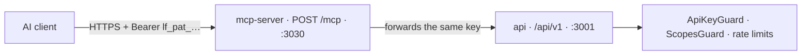

# 0005. MCP server: connect AI assistants to your training data

- Status: Accepted, implemented
- Date: 2026-11-14
- Deciders: Tony Meissner

## Context and problem statement

Users want to ask an AI assistant (Claude Desktop/Code, Cursor, VS Code, ChatGPT and other
MCP clients) questions about their own training: "How did my bench press develop this
year?", "Did I hit my protein goal last week?". LukiFitti already has a personal API key
system with scopes (ADR 0003) and a read-only public API v1, so an MCP server can sit on
top without new access-control logic.

## Decision drivers

- The MCP server must hold no data and no secrets of its own; all enforcement stays in the
  API (owner filters, scopes, rate limits — deny by default).
- The same architecture already runs at marienmühle and kds-werkzeugbau; copying it is
  safer than inventing a new one — except its shared-secret auth, which does not fit
  per-user access.
- Assistant answers must match the app, so calculations reuse `@luki-fitti/common`.
- Keep the prompt-injection surface small: read-only tools and no user free text in
  outputs.

## Considered options

- **Auth:** the marienmühle shared secret (`x-mcp-secret`) — rejected, callers are users'
  assistants, not our backend; forwarding the user's `lf_pat_` key — chosen.
- **Placement:** tools inside `apps/api` vs. a standalone `apps/mcp-server` — standalone
  chosen, matching the proven setup and keeping MCP dependencies out of the API.
- **`tools/list` visibility:** public vs. key-required — key-required, so the list can be
  filtered by the key's scopes; only the handshake stays public.
- **Endpoint URL:** subdomain vs. a path on the app domain — path chosen:
  `https://app.luki-fitti.tony-luke.de/mcp` (also routed on the site domain).
- **OAuth 2.1** for one-click connectors (claude.ai, ChatGPT) — postponed; a pasted key
  ships in 2.0, OAuth can later issue the same `lf_pat_` keys in front of the same server.
- **Write tools** — out of scope until `write:*` scopes exist.

## Decision outcome

- **Standalone NestJS app** `apps/mcp-server` (`@luki-fitti/mcp-server`) using
  `@rekog/mcp-nest`, `@modelcontextprotocol/server`, `/node` and `/core`, pinned exact and
  vetted. Streamable HTTP transport, stateless, JSON responses, served at `POST /mcp` only.
- **The server holds no data, database access or secrets.** Every tool call becomes one or
  more `GET /api/v1/...` requests carrying the caller's key, so a bug in the MCP server
  cannot read anyone else's data.
- **Auth (`McpAuthGuard`):** `initialize`, `notifications/initialized` and `ping` are
  public; every other method including `tools/list` needs `Authorization: Bearer lf_pat_…`
  (format check only). The guard introspects via the new `GET /v1/key` (`{ scopes,
expiresAt }`), cached 60 s per key hash; a key without the `mcp` scope gets 403.
  `tools/list` is filtered to the scopes the key holds. Keys are never logged — the key id
  is.
- **API additions owned by this feature:** the `mcp` scope (with an "AI assistant (MCP)"
  preset in the key-creation sheet), `GET /v1/key`, `AppSettings.mcpEnabled` (kill switch,
  default off — `/v1/key` answers 403 `mcp_disabled`), and `GET /v1/sessions?include=
exercises` (full rows, limit ≤ 50) so tools fetch sets without one request per session.
- **Nine read-only tools:** `get-profile`, `list-sessions`, `get-session`,
  `exercise-progress`, `personal-records`, `training-summary`, `list-workouts`,
  `nutrition-summary`, `body-weight-trend`. Calculations reuse `@luki-fitti/common`
  (`history-insights`, `muscle-volume`, `nutrition`, `body-weight`, `progression` e1RM).
  Exercise names resolve with `exercise-search.util` (EN/DE); ambiguity returns candidates
  instead of guessing. Dates accept `YYYY-MM-DD` or relative words in the user's time zone.
  Outputs are a short text plus `structuredContent`, capped at 200 rows with a
  `truncated` flag. No user free text (notes, descriptions) in outputs.
- **Rate limits:** the API's limits apply to forwarded calls; the MCP server additionally
  caps tool calls at 30/min per key.
- **Routing:** Caddy `handle /mcp` (exact path — the transport serves only `/mcp`) →
  `mcp-server:3030`; a fourth production image `tuke307/luki-fitti-mcp-server`; the server
  calls `API_BASE_URL` inside the compose network. DNS-rebinding protection via
  `MCP-Protocol-Version`/`Origin` checks with the public host allowed.
- **Docs:** the user guide lives on the docs site (`docs/mcp.md`, "Connect an AI
  assistant") in the API tab's MCP group; the docs site also exposes `/llms.txt` and
  `/llms-full.txt`. This replaces the originally planned `/developers` MCP section.

### Consequences

Good: per-user least-privilege access reusing the existing scope model; no new
access-control surface; a revoked key stops working within a minute; assistants get
calculated answers identical to the app.

Bad: a fourth deployable image; tool calls multiply API request volume (mitigated by the
30/min tool cap and `include=exercises`); pasted-key UX is weaker than OAuth connectors.

## Implementation notes

- `GET /v1/key` exists solely for introspection (scopes + expiry), cached 60 s.
- Every forwarded call sends `X-Forwarded-For: <caller ip>` — the API's failed-key counter
  is per IP and the API trusts exactly one proxy hop, so without it a few bogus keys would
  lock out every MCP user.
- `exercise-progress` needs `read:sessions` + `read:workouts` (it resolves names against
  `/v1/exercises`).
- `profileFor` memoises `/v1/me` once per tool call; without `read:profile` tools answer
  in kg and omit goals.
- Tool constructors need explicit `@Inject(...)`: tsx/esbuild drops `design:paramtypes` in
  tests. `@nestjs/microservices` is pinned to 12.1.2 (12.5.x needs a newer
  `@nestjs/core`).
- Truncated fetches are surfaced (`truncated: true` + hint), never silent: sessions 400
  rows, streak lookback 600, exercises/meals/body-weight 1000.
- Ops after merge: create `apps/mcp-server/.env.sample`, add the service in Coolify, turn
  on the `mcpEnabled` switch at `/admin/api-keys`.

## Links

- ADR 0003 (personal API keys) · ADR 0004 (docs site)
- User guide: `docs/mcp.md` (published on the docs site)
